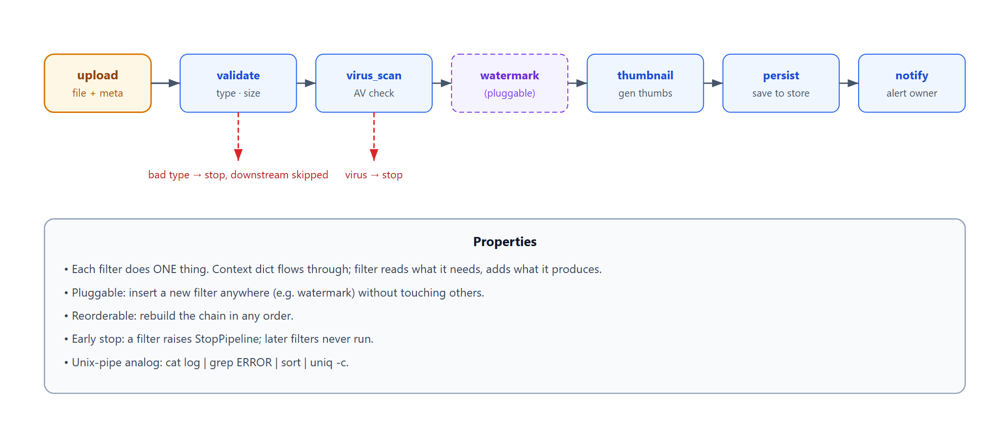
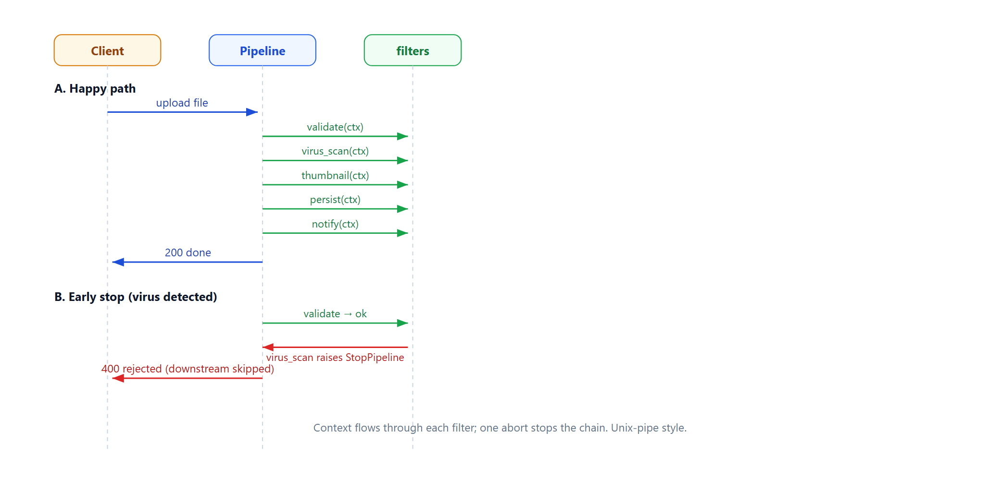

# Learn Pipes-and-Filters — Pipeline Pattern Demo

> **Learning / study repo. Self-contained demo, NOT production code.**
> Shows how to split one request into a chain of single-responsibility filters, where
> data flows through a pipeline and each stage can be plugged in, reordered, or removed.

## The idea

One incoming request is NOT handled by one big function. It is split into ordered
stages (filters). A context dict flows through them; each filter does one thing and
passes the context on.

```
 upload file
    │
    ▼
 [validate] → [virus_scan] → [thumbnail] → [persist] → [notify]
   filter1      filter2         filter3       filter4     filter5
```

Analogous to Unix pipes: `cat log | grep ERROR | sort | uniq -c`.



## Why this pattern

- **Single responsibility per filter** — validate knows nothing about persistence.
- **Pluggable** — add a watermark filter by inserting it between virus_scan and thumbnail;
  no other filter changes.
- **Reorderable** — swap stage order by rebuilding the chain.
- **Testable** — test each filter in isolation with a fake context.
- **Early stop** — a filter can abort the pipeline (bad type, virus detected),
  downstream filters never run.

## Run

```bash
python run_all.py
```

Pure Python standard library.

## Demo cases

1. **Happy path** — upload a valid PNG through all 5 filters.
2. **Plug in a new filter** — insert `watermark` after `virus_scan`; chain grows, others untouched.
3. **Early stop on bad type** — `.exe` rejected at validate; later filters never run.
4. **Early stop on virus** — `evil.png` stopped at virus_scan.
5. **Reorder** — move `notify` before `thumbnail`; pipeline runs in new order.

## Flow



## Sibling repos

- `learn_microservice_by_id` — one DB per service, chained by ID.
- `learn_outbox_pattern` — reliable event delivery without distributed txn.
- `learn_distributed_txn` — pre-freeze + state machine for cross-service consistency.
